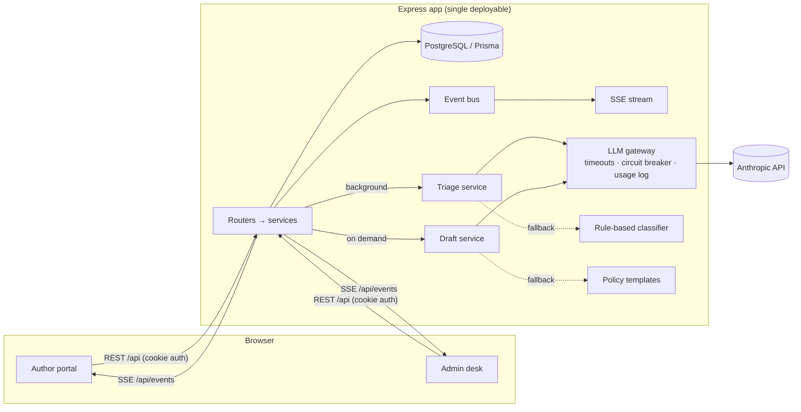

# BookLeaf Author Support & Communication Portal

A web app for BookLeaf Publishing's author support: an **author portal** (books, royalties, support tickets with live replies) and an **admin support desk** (urgency-sorted queue, AI triage, AI-drafted replies grounded in BookLeaf's knowledge base, internal notes, assignment), on a documented REST API.

- **Stack:** TypeScript end to end · Node 22 + Express 5 · PostgreSQL + Prisma · React 19 + Vite + TanStack Query · Anthropic Claude (Haiku 5.5 for triage, Opus 5.5 for drafts) · Server-Sent Events
- **Live demo:** `<add your deployed URL here>` (see [Deployment](#deployment))
- **API docs:** `/api/docs` (Swagger UI) · raw spec: [`server/openapi.yaml`](server/openapi.yaml)
- **Write-up:** [`WRITEUP.md`](WRITEUP.md)

## Test credentials

The database is seeded from `bookleaf_sample_data.json` (10 authors, 18 books) plus 8 demo tickets. The login page has one-click buttons for these accounts.

| Role | Email | Password | Why this account is interesting |
|---|---|---|---|
| Author | `priya.sharma@email.com` | `Author@123` | 2 published books, ₹3,570 pending |
| Author | `kavita.deshmukh@email.com` | `Author@123` | 1 book in production (typesetting) + ₹850 pending, below the ₹1,000 payout threshold |
| Author | `ananya.reddy@email.com` | `Author@123` | Royalty never paid since publication |
| Author | any other author in the dataset | `Author@123` | — |
| Admin | `admin@bookleaf.com` | `Admin@123` | Neha Iyer |
| Admin | `support@bookleaf.com` | `Admin@123` | Karan Mehta (second agent, for assignment) |

---

## Running locally

**Prerequisites:** Node.js ≥ 20.11 and Docker (for Postgres).

```bash
git clone <repo-url> && cd bookleaf-support-portal
npm install
cp .env.example server/.env          # then set JWT_SECRET (openssl rand -hex 32) and, optionally, ANTHROPIC_API_KEY
npm run db:up                        # Postgres 16 on localhost:5432 (docker compose)
npm run db:migrate                   # apply Prisma migrations
npm run db:seed                      # load the sample dataset + demo tickets
npm run dev                          # API on :4000, web app on http://localhost:5173
```

Without an `ANTHROPIC_API_KEY` the app runs in **AI-offline mode**: tickets are classified by a rule-based classifier and replies start from policy templates. A banner in the admin UI says so. Everything else works the same, which also shows how the app degrades when the AI is unavailable.

**Everything in Docker (production build):**

```bash
ANTHROPIC_API_KEY=sk-ant-... docker compose --profile full up --build    # http://localhost:4000
```

**Tests** (unit tests need nothing; integration tests use a separate `bookleaf_test` database on the same Postgres):

```bash
npm run test --workspace server              # all 64 tests
npm run test:unit --workspace server         # unit only, no database needed
```

---

## What's implemented

| Brief requirement | Where |
|---|---|
| Email/password login; authors see only their data | `server/src/http/auth.ts`, row scoping in every service query; other authors' resources return **404** so IDs can't be probed |
| My Books: title, ISBN, genre, publication date, status, MRP, copies, earned/paid/pending | `client/src/pages/author/BooksPage.tsx`: royalty summary, next payout date, threshold note, production progress for unpublished books |
| Submit query: book dropdown incl. "General / Account level", subject, description, attachment | `NewTicketPage.tsx` → `POST /api/tickets`. File upload is implemented (JPG/PNG/WEBP/PDF ≤ 5 MB), not just the UI |
| My Tickets with status + admin responses, updating without refresh | `MyTicketsPage.tsx`, `AuthorTicketPage.tsx`, SSE via `useTicketEvents.ts` |
| Ticket queue filterable by status, category, priority, date; urgent and oldest easy to spot | `QueuePage.tsx`: urgency sort (untriaged → Critical → Low, then oldest), "Overdue" flag when no first reply within the priority's target, assignee filter, search, filters kept in the URL |
| AI auto-classification into the 6 categories, admin override | `ai/triageService.ts`, `TriageCard.tsx` |
| AI priority score (Critical/High/Medium/Low), admin override | same; overrides are kept separate from the AI's answer and never overwritten by re-triage |
| AI-drafted response from query + knowledge base; editable; appears on author's view | `ai/draftService.ts`, `ReplyComposer.tsx` |
| Update status, internal notes, assign to self | `TicketSidebar.tsx`, `PATCH /api/tickets/:id`, `POST /api/tickets/:id/messages` with `visibility: INTERNAL` |
| REST API, auth middleware, RBAC, validation, meaningful errors, docs | Express routers per module, zod validation, one error envelope, OpenAPI 3.1 + Swagger UI |
| API keys in env only; graceful degradation; cost awareness; model choice | See [AI integration](#ai-integration) |

**Extras:** reply/reopen flow for authors (replying to a *resolved* ticket reopens it; *closed* tickets ask for a new one); "send & resolve" in one action; checklist of the commitments an AI draft makes; activity log; AI usage, cost and quality page (`/admin/insights`); dark mode; mobile layout.

---

## Architecture



```
server/
  prisma/schema.prisma        data model + migrations
  openapi.yaml                API spec (served at /api/docs)
  src/
    app.ts, index.ts          app factory / bootstrap (+ triage sweeper, graceful shutdown)
    config/env.ts             zod-validated environment (fail fast at boot)
    http/                     auth (JWT cookie/Bearer, requireRole), validation, error handler
    modules/                  auth · books · tickets · admin (routes → service → serializer)
    domain/                   pure business rules: taxonomy, production stages, royalty schedule
    ai/                       gateway, prompts, knowledge base, account facts, triage, drafts, fallbacks
    realtime/                 event bus + SSE endpoint
    db/seed.ts                idempotent seed from the provided JSON
  tests/unit, tests/integration
client/src/
  api/                        fetch wrapper, DTO types, React Query hooks
  realtime/useTicketEvents.ts SSE → query invalidation
  pages/author, pages/admin   screens; components/ shared UI
```

### Key decisions

- **Modular monolith, one deployable.** Express serves the API and the built SPA from one origin. The httpOnly session cookie and EventSource work without CORS, and there is one service to deploy. The module boundaries (routes → service → serializer, with AI behind a gateway) are where it would split if it ever needed to.
- **PostgreSQL + Prisma.** The data is relational (authors → books → tickets → messages), and typed queries keep RBAC scoping easy to read. Money is `Decimal(12,2)`. The status strings in the dataset are mapped onto a `BookStage` enum that follows the KB's production pipeline, so "what comes next" is data rather than string parsing.
- **Effective vs suggested classification.** A ticket stores the effective `category`/`priority` (what the queue uses), who set it (`AI`/`RULES`/`ADMIN`), and the AI's original answer. Re-running triage never clobbers an admin override, and the override rate becomes a measurable accuracy signal.
- **One timeline, two visibilities.** Replies and internal notes share a table with a `visibility` column, so the admin sees one ordered conversation. The author serializer is an allow-list, so a new internal field can't leak by default.
- **Realtime via SSE, events carry no data.** Updates only flow server → browser, so SSE is simpler than WebSockets, works through proxies, and reconnects by itself. Each event is just `{type, ticketId}` and the client refetches through the normal API. That keeps role-based serialization in one place, and an author's stream only receives events for their own tickets. With several instances, the in-process bus becomes Postgres `LISTEN/NOTIFY` or Redis behind the same interface.
- **Business rules in code, not in prompts.** Payout dates (quarter end + 45 days), the ₹1,000 threshold rollover and "payout cycles missed since last payout" are computed in `domain/royalty.ts` and unit-tested. The model receives them as facts.

---

## AI integration

### Models and why

| Task | Model | Settings | Why |
|---|---|---|---|
| Triage (category, priority, confidence, 1-line summary, rationale) | `claude-haiku-5-5` | structured output (zod schema), effort `low`, 2k max tokens | High-volume classification into a fixed schema. Haiku is fast (keeps the queue fresh) and costs about $0.10 per million input tokens. The brief suggests Haiku for this kind of work. |
| Reply drafts (email body + internal follow-up actions) | `claude-opus-5-5` | structured output, effort `low` (configurable) | This text goes to authors, so tone, accuracy and following policy matter most. Low effort keeps latency and cost down; drafts are generated at most once per author message. |

Both are environment variables (`AI_TRIAGE_MODEL`, `AI_DRAFT_MODEL`, `AI_DRAFT_EFFORT`). Pointing drafts at Haiku makes them about 40× cheaper if quality holds up on real traffic. The Insights page shows override rate and draft adoption to judge that.

### Triage flow

1. `POST /api/tickets` commits the ticket and returns immediately. Triage runs **in the background** and the result reaches admins over SSE ("Classifying…" → badge).
2. The prompt has a static system block (role, category definitions, priority rubric, rules), which is prompt-cached. The user turn holds the ticket plus a **brief account snapshot** for the selected book (stage, pending royalty, payout cycles since last payout, threshold status). The facts calibrate priority: "no royalty for 6 months" with three missed payout cycles is Critical, while "₹850 not paid" is Medium because it is below the threshold and rolls over.
3. Output is a schema-validated object (`messages.parse` + `zodOutputFormat`), so there is no fragile JSON parsing.
4. If the call fails for any reason, the **rule-based classifier** (`ai/fallback/ruleBasedTriage.ts`) classifies instead. It uses keywords plus the same account facts and errs toward higher priority. The ticket is marked `FALLBACK` with low confidence, and admins can **Re-run AI triage** later.
5. A **sweeper** re-processes tickets left `PENDING` (e.g. after a server restart mid-triage).

### Draft flow

1. When an admin opens a ticket, `GET /api/tickets/:id/draft` returns the cached draft, or generates one **only if BookLeaf owes a reply** (the author spoke last). Re-opening a ticket costs nothing; a new author message makes the draft stale. Concurrent opens share one generation.
2. The prompt has three layers:
   - **System block 1 (cached, same for every ticket):** persona, the KB's tone guidelines, company overview, and writing rules: ground every number in the facts, only promise timelines the KB defines, own BookLeaf's mistakes, never mention internal notes or AI, sign off as the agent.
   - **System block 2 (cached per category):** only the KB sections that category needs (royalty policy for royalty tickets, etc.), plus BookLeaf's matching *Sample Query → Response* examples for calibration.
   - **User turn:** ticket reference, the **full account facts** for the relevant book (figures, last payout, computed next payout date, threshold status, platforms, today's date), and the conversation: the opening message always, then the last 7 messages (each capped at 1,500 characters), with internal notes marked *never quote*.
3. The output is `{ reply, internal_actions }`. The admin sees the draft in an editor with a checklist of what it commits the team to (e.g. "Trigger Amazon re-sync for Howrah Nights"), so promises in the email don't get forgotten.
4. If the call fails, a **policy-correct template** for the category is filled with the same computed facts, so the offline draft still cites real amounts and dates. The admin sees why the template was used ("AI rate limit reached", …).

### Prompt-injection hygiene

Author text is treated as data. It's wrapped in tags with `<`/`>` escaped so it can't close the tags, the system prompts say to ignore instructions inside it, and outputs are schema-constrained. Drafts are always reviewed by a human before sending.

### Error handling and graceful degradation

All model calls go through `ai/llmGateway.ts`, which never throws. It returns `{ok: true, data}` or `{ok: false, reason}`:

| Situation | What happens |
|---|---|
| No API key | Gateway is `disabled` and skips the call immediately: rules triage + template drafts. Admin banner: "AI assistance is off". |
| Timeout (30s) / 5xx / overloaded / rate limit (429) | SDK retries once, then the call fails over to the fallback. 3 consecutive failures **open a circuit breaker** for 60s, so calls are skipped instead of each ticket waiting on a timeout. One trial call is let through after the cooldown. Admin banner: "temporarily unavailable". |
| Auth error | Same, logged as `auth_error`. |
| Refusal / truncated / invalid output | Fallback, without counting against provider health. |
| Any AI failure | **Ticket creation never depends on the AI.** Admins can always write and send replies manually. |

Every call (including skipped ones) is logged in `AiCallLog` with task, model, outcome, tokens, cache reads/writes, latency and estimated cost. `/admin/insights` summarizes spend, fallback counts, latency, prompt-cache reads, **override rate** (how often admins correct the AI) and **draft adoption** (replies sent as-is vs edited vs written manually).

### Cost management

- **Model per task:** a small model for classification, a stronger one only for author-facing text.
- **Lazy, cached drafts:** at most one draft per author message, none when BookLeaf spoke last, none for tickets nobody opens.
- **Scoped context:** only the KB sections for the ticket's category, only the relevant book's facts (not the author's whole catalogue), a capped conversation window, and a brief fact set for triage.
- **Prompt caching:** static instructions come first with `cache_control` breakpoints (system core, then per-category KB). Cache reads bill at 10% of input. The Insights page shows cache-read tokens so caching is verifiable. Nothing volatile (dates, IDs) goes in the cached prefix.
- **Low effort + structured output:** fewer thinking tokens and no retry-to-parse loops.
- **Circuit breaker:** no paying for doomed calls during an outage.
- **Rough estimate** at list prices (verify against the Insights page): triage ≈ 1k input / ~300 output tokens on Haiku ≈ **$0.0003 per ticket**. A draft ≈ 2–2.5k input (mostly cached) / ~500 output on Opus at low effort ≈ **$0.01–0.02 per draft**. 3,000 tickets/month comes to roughly $40–60/month, or a few dollars with Haiku drafts.

---

## API

Full reference: **Swagger UI at `/api/docs`** (try requests after **Authorize** with the token from login) and [`server/openapi.yaml`](server/openapi.yaml).

| Method | Path | Who | Purpose |
|---|---|---|---|
| POST | `/api/auth/login` | public | Sign in, set session cookie, return JWT |
| POST | `/api/auth/logout` | public | Clear cookie |
| GET | `/api/auth/me` | any | Current user |
| GET | `/api/books` | author / admin | Own books + royalty summary / all books (`?authorId=`) |
| GET | `/api/books/:id` | author / admin | One book (404 if not yours) |
| GET | `/api/tickets` | author / admin | Own tickets / queue with `status, category, priority, assignee (me/unassigned/id), from, to, q, sort, page, pageSize` |
| POST | `/api/tickets` | author | Create (JSON or multipart with `attachment`) |
| GET | `/api/tickets/:id` | author / admin | Role-specific view (admins also get notes, triage, activity, author context) |
| PATCH | `/api/tickets/:id` | admin | `status`, `category`, `priority` (overrides), `assigneeId` |
| POST | `/api/tickets/:id/messages` | author / admin | Reply; admins can post `INTERNAL` notes, pass `draftId`, set `status` |
| GET | `/api/tickets/:id/draft` | admin | AI draft (cached / generated / not_needed) |
| POST | `/api/tickets/:id/draft` | admin | Regenerate draft |
| POST | `/api/tickets/:id/triage` | admin | Re-run AI triage (keeps admin overrides) |
| GET | `/api/tickets/:id/attachments/:attachmentId` | owner / admin | Download (always as attachment) |
| GET | `/api/events` | author / admin | SSE stream, scoped by role |
| GET | `/api/admin/agents` · `/ai-status` · `/metrics` | admin | Team list, AI mode, queue + AI metrics |

**Auth:** httpOnly `SameSite=Lax` cookie for the web app (not readable by JS, not sent on cross-site POSTs), or `Authorization: Bearer <jwt>` for API clients. The user is re-loaded on each request, so a deleted account loses access immediately.
**Errors:** always `{"error": {"code", "message", "details?"}}`. Codes: `VALIDATION_ERROR` (400, field-level `details`), `UNAUTHENTICATED` (401), `FORBIDDEN` (403), `NOT_FOUND` (404), `CONFLICT` (409), `UPLOAD_ERROR` (400/413), `RATE_LIMITED` (429), `INTERNAL_ERROR` (500, logged with request id, no internals leaked).
**Rate limits:** login 20/15 min per IP; ticket creation 20/hour per user; draft regeneration and re-triage 60/hour per admin.

---

## Deployment

The repo deploys as one Docker service plus Postgres.

- **Render (blueprint included):** New → Blueprint → pick the repo. `render.yaml` provisions the web service and a Postgres database, and generates `JWT_SECRET`. Set `ANTHROPIC_API_KEY` in the dashboard. On start, the container runs migrations, seeds the dataset (idempotent) and serves the app.
- **Railway / Fly / any VPS:** build the `Dockerfile`; set `DATABASE_URL`, `JWT_SECRET` (≥ 32 chars) and `ANTHROPIC_API_KEY`.

---

## Assumptions

- **Royalty figures come from the dataset as-is.** The KB's 80/20 net-profit split is explained to authors, but per-copy royalties are taken from `author_royalty_per_copy`. The data has no per-quarter breakdown, so "possibly overdue" means *pending ≥ ₹1,000 and at least one payout deadline has passed since the last payout*. The AI is told this needs finance verification.
- **The ₹1,000 threshold applies to an author's total pending balance**, not per book.
- **Dates are relative to "today".** The sample data's last payouts are from 2025, so with today's date most pending balances look overdue, and the AI responds accordingly.
- **Admins are a flat team** (no supervisor roles); any admin can see and act on any ticket.
- **Response targets for the "Overdue" flag** (Critical 4h, High 24h, Medium 48h, Low 72h) are my own placeholders; the KB doesn't define them.
- **The demo password is shared by all seeded authors** to make evaluation easy.

## Known limitations / what I'd do next

- **Evaluate the prompts on real tickets:** build a labelled set from historical tickets, measure category/priority accuracy and draft quality (LLM-as-judge plus agent ratings), then tune. The override rate is the live proxy until then.
- **Refusal fallback:** a draft the model declines currently drops to the policy template. Anthropic's server-side `fallbacks` (beta) could retry on another model in the same call first.
- **Scale-out:** move the event bus to Postgres `LISTEN/NOTIFY`/Redis and triage to a durable queue (BullMQ / pg-boss) with retries. The current in-process sweeper is the minimum viable version.
- **Attachments** go to local disk (ephemeral on most PaaS). Next step is S3/R2 with signed URLs, a virus scan, and passing images to the model for print-quality tickets.
- **Retrieval** is a category → KB-section map, which suits a 1.5k-token KB. A larger help centre would need hybrid search (BM25 + embeddings) behind the same `renderCategoryKnowledge` seam.
- **Notifications:** email the author when BookLeaf replies, and nudge them when a ticket waits on them.
- **Auth hardening:** password reset, account lockout, refresh-token rotation, audit of admin actions beyond the ticket activity log.
- **Dependency advisory:** `npm audit` reports a `deepmerge-ts` advisory inside the Prisma CLI's config loader. It only processes our own config, never user input; I'd revisit it when moving to Prisma 7.
